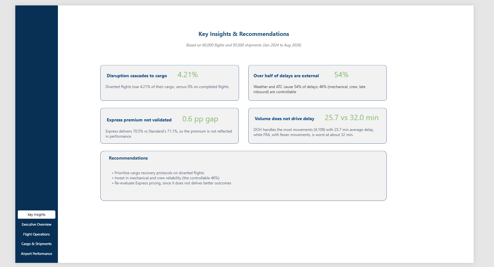
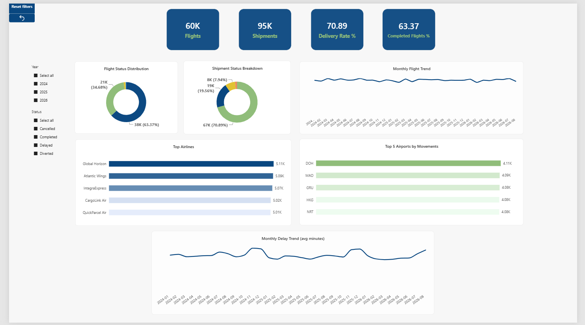
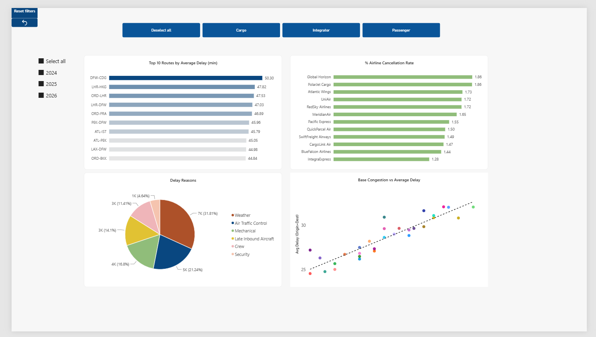
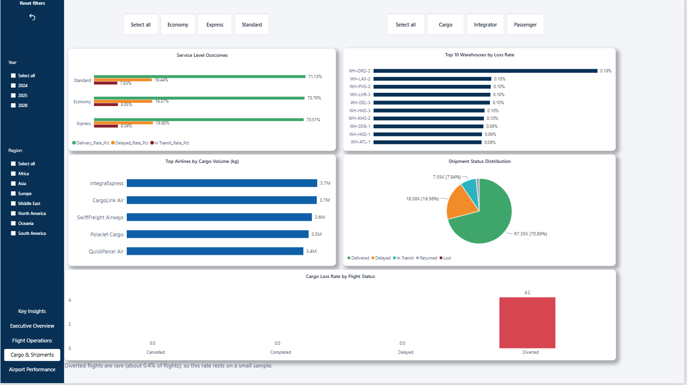
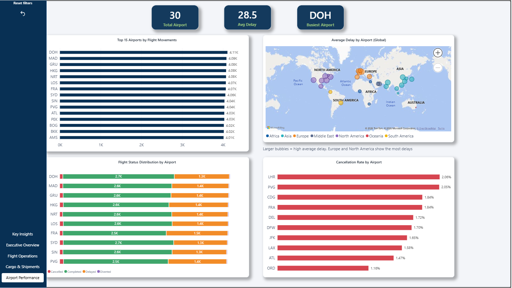
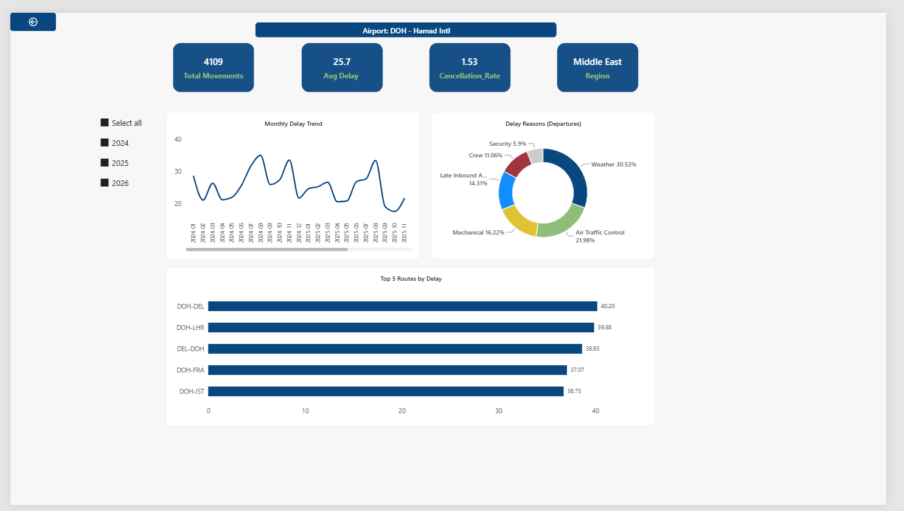

# Aviation & Air Cargo Operations Analysis

An end-to-end data analytics project using **SQL (SQLite)** and **Power BI** to analyze flight delays, airport performance and cargo shipment outcomes for a synthetic aviation and air-cargo network.

> **Note:** The dataset is synthetic (generated for this project). Findings describe this dataset and should not be read as statements about real airlines or airports.

---

## Business Questions

1. Which routes, airlines and airports have the most delays and cancellations?
2. What causes delays, and how much of it is controllable?
3. Does airport traffic or congestion drive delays?
4. Do premium cargo service levels (Express) deliver better outcomes?
5. How do flight disruptions affect the cargo they carry?

---

## Dataset

Six tables stored in `aviation_logistics.db` (SQLite):

| Table | Rows | Description |
|---|---|---|
| `airports` | 30 | Airport, region, hub size, base congestion, coordinates |
| `airlines` | 12 | Airline, carrier type (Passenger / Cargo / Integrator), alliance |
| `aircraft` | 220 | Tail number, model, category (Narrowbody / Widebody / Freighter), capacity |
| `warehouses` | 76 | Cargo warehouses located at airports |
| `flights` | 60,000 | Flights from Jan 2024 to Aug 2026 (status, delay minutes, delay reason) |
| `shipments` | 95,000 | Cargo shipments, each linked to one flight |

Relationships: `shipments → flights → airlines / aircraft / airports (origin and destination)` and `shipments → warehouses (origin and destination)`.

---

## Data Quality Checks

Seven checks were run in SQL before any analysis (see `data_quality_checks.sql`):

| Check | Result |
|---|---|
| Duplicate primary keys | None |
| Orphan shipments (no matching flight) | None |
| Delivery date earlier than creation date | None |
| Flight status consistent with actual departure/arrival | Consistent |
| Negative or impossible numeric values | None |
| Aircraft category consistent with passenger capacity | Consistent |
| Shipment created after flight departure | None |

**Observation:** `delay_minutes` has a maximum of exactly 480 (8 hours), which suggests clipping in the source data.

---

## Key Findings

1. **Flight disruption cascades to cargo.** Cargo on diverted flights has a 4.21% loss rate, while completed and delayed flights show 0%. Diverted flights are rare (about 0.4% of flights), so this rate rests on a small sample.
2. **Over half of delays are external.** Weather (about 31.8%) and air traffic control (about 21.2%) account for roughly 54% of delays. The other 46% (mechanical, crew, late inbound aircraft) are controllable.
3. **The Express premium is not reflected in outcomes.** Delivery rates are 70.5% (Express), 70.8% (Economy) and 71.1% (Standard), with near-identical delay and loss rates.
4. **Traffic volume does not drive delay, but structural congestion does.** DOH handles the most movements (4,109) with a 25.7 min average delay, while FRA (about 32 min) is among the slowest. Airports with higher base congestion show higher average delay.
5. **Cancellation rates are uniform across airlines** (1.28% to 1.86%), pointing to system-wide causes rather than specific carriers.
6. **Cargo and integrator carriers move about 10x more weight** than passenger airlines.
7. **Warehouse loss is negligible** (at most 0.19%, about 2 lost shipments of 1,035 at the worst warehouse), so differences between warehouses are statistical noise.
8. **No seasonality** appears in flight counts or delay (a limitation of the synthetic data).

---

## SQL Skills Demonstrated

- Joins across six tables, including joining the same table twice (origin and destination airports)
- CTEs and window functions (`ROW_NUMBER`, `RANK`, `DENSE_RANK` with `PARTITION BY`)
- `UNION ALL` to count both departures and arrivals per airport
- Conditional aggregation with `CASE WHEN` inside `SUM`
- Date arithmetic with `julianday()` and `strftime()` (SQLite)
- Orphan and integrity checks with `LEFT JOIN ... IS NULL`

---

## Power BI Dashboard

Six pages with slicers (year, status, region, service type, carrier type), a Reset filters button, and a drill-through page:

| Page | Content |
|---|---|
| **Key Insights** | The main findings and recommendations |
| **Executive Overview** | KPIs, flight and shipment status, monthly trends, top airlines and airports |
| **Flight Operations** | Top 10 routes by average delay, airline cancellation rate, delay reasons, congestion vs delay |
| **Cargo & Shipments** | Service level outcomes, warehouse loss rate, cargo volume by airline, cargo loss by flight status |
| **Airport Performance** | Top 15 airports by movements, global delay map, status distribution, cancellation rate |
| **Airport Detail** (drill-through) | Movements, delay trend, delay reasons and worst routes for a selected airport |

**Modeling notes**
- Airport movements count both departures and arrivals, using `USERELATIONSHIP` on the inactive destination relationship.
- A `YearMonth` column keeps monthly trends in correct chronological order.

### Screenshots








---

## Recommendations

- Add cargo recovery protocols for diverted flights, where losses are concentrated.
- Invest in mechanical and crew reliability, the controllable 46% of delays.
- Re-evaluate Express pricing, since it does not deliver better outcomes in this data.

---

## Definitions and Limitations

- **Average delay** is calculated across all flights, including diverted flights. Completed flights have zero delay, and cancelled flights have no delay value.
- **Completed Flights %** (63.37%) is the share of flights with status Completed (no delay).
- **Delivery Rate** (70.89%) is the share of shipments with status Delivered.
- Data for **2026 covers January to August only**.
- The data is **synthetic**, so some patterns (such as no seasonality) differ from real operations.
- Small differences between airlines, airports and warehouses are likely noise and should not be over-interpreted.

---

## Tools

SQL (SQLite) · Power BI Desktop

## Repository Structure

```
├── aviation_logistics.db
├── data_quality_checks.sql      # data quality checks + 10 business queries
├── Aviation_Logistics_Dashboard.pbix
├── screenshots/
└── README.md
```
